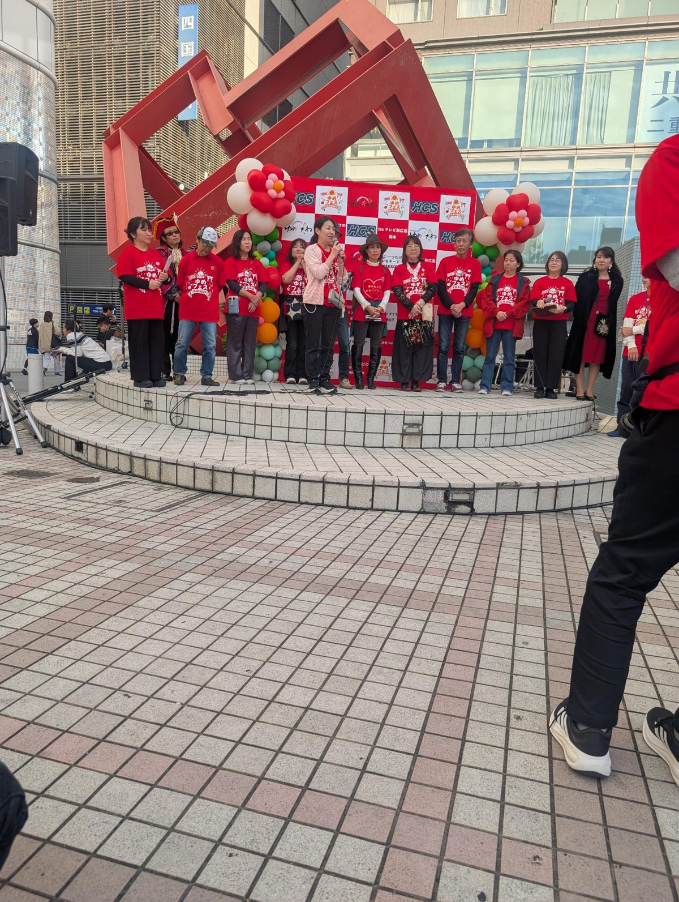
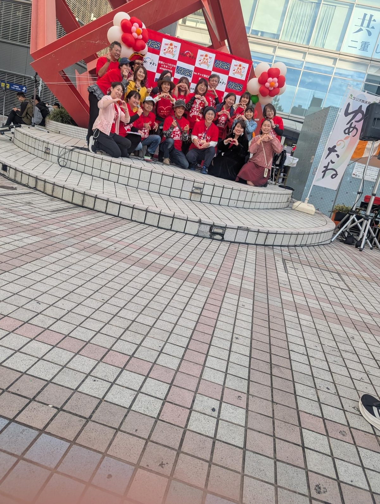

こんにちは、地球活性化実行委員会の岡ちゃんです。

11月1日（日）、広島市中区新天地のアリスガーデンで開かれた「夢フェス広島2026」に参加してきました。ラジオ番組「ゆめのたね」の公開収録イベントで、会場はたくさんの笑顔でいっぱいでした。

## ステージのようす

赤いおそろいのTシャツを着たスタッフのみなさん、出演者のみなさんが、会場を盛り上げてくれました。夢を声に出して語る人たちの姿を見て、僕自身もたくさん元気をもらいました。

## 最後はみんなでハートポーズ

最後はみんなで手でハートを作って記念撮影。あたたかい空気に包まれたまま、イベントは終わりました。

## いっしょに動く仲間を探しています

地球活性化実行委員会は、「障がいがあってもなくても、自然につながれる場所を広島に増やしたい」という思いで動いています。夢フェスのように、人と人がつながる場を、これからも一緒につくっていける仲間を探しています。企画・SNS・動画・音楽・交流・裏方など、得意なことで関わってもらえたらうれしいです。

気になった方は、このホームページの「仲間募集」や、Instagram（[@ayu19841002](https://www.instagram.com/ayu19841002/)）から気軽に声をかけてください。

夢フェスを運営されたみなさん、出演者のみなさん、会場に来てくださったみなさん、本当にありがとうございました！
